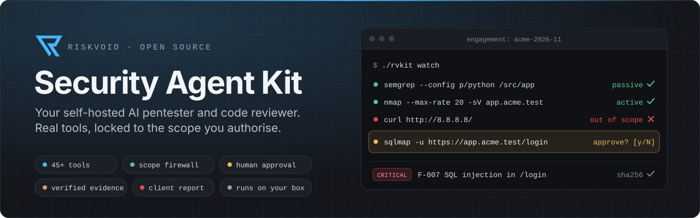
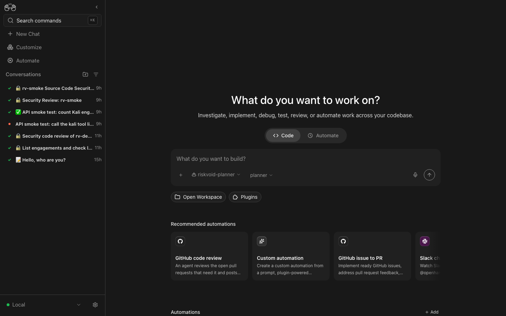
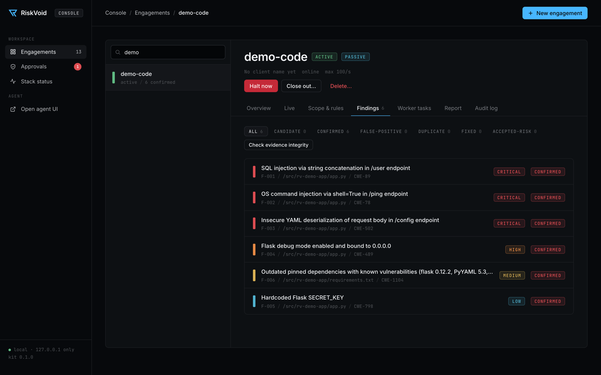
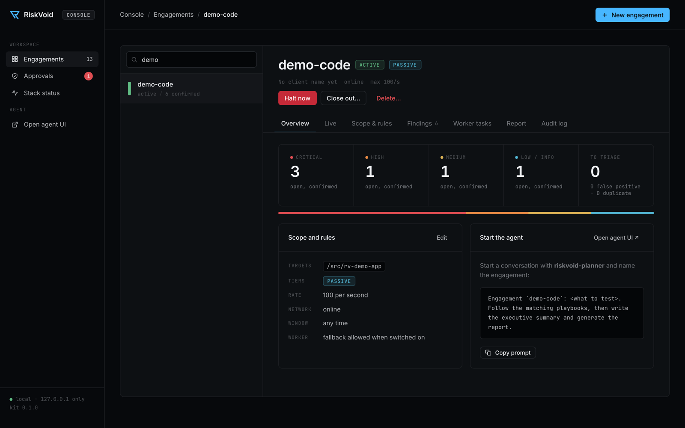
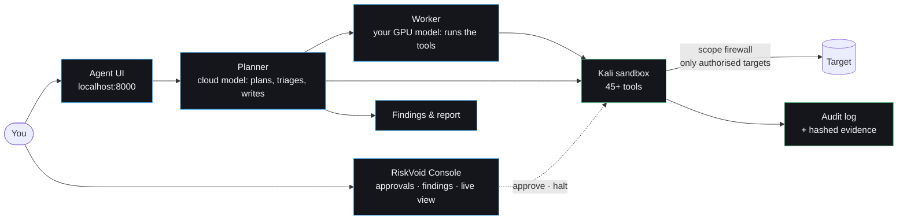

<p align="center">
  
</p>

<p align="center">
  <a href="LICENSE"></a>
  
  
  
  
  <br>
  
  
  
  
</p>

<p align="center">
  <b>An AI security agent you run on your own machine.</b><br>
  It reviews code and tests web apps, APIs, AI apps and networks with real security tools,<br>
  stays inside the scope you authorise, asks before anything risky, and writes the client report.
</p>

<p align="center">
  <a href="#quick-start">Quick start</a> ·
  <a href="#what-it-can-do">What it can do</a> ·
  <a href="#where-the-worker-model-runs">No GPU? Fine</a> ·
  <a href="#the-console">Console</a> ·
  <a href="#run-it-from-claude-code-or-another-coding-agent">With Claude Code</a> ·
  <a href="#how-it-works">How it works</a> ·
  <a href="#safety-built-in">Safety</a> ·
  <a href="docs/README.md">Documentation</a>
</p>

> [!WARNING]
> **For authorised work only.** Use it on systems you own or have written permission to test.

---

## What is this?

The Security Agent Kit is a ready-to-run **AI security assistant** for penetration testers, security engineers
and consultants. You describe the job in plain language: *"review this repo"* or *"test this API"*. The agent
then plans the work, runs the tools, checks what it finds and hands you a branded report.

It's built so you can **trust it on client work**:

-  **Two models, one team.** A strong cloud model **plans** and writes. A separate **worker** model runs the tools and reads the client's code, so raw tool output and source code stay with the worker. The worker can run on your own GPU, a rented one, or a hosted model, so **you don't need a GPU**.
-  **A locked sandbox.** Every tool runs in a Kali Linux sandbox with a firewall that only reaches the targets you authorised. Nothing else is reachable.
-  **You stay in charge.** Risky (intrusive) steps wait for your approval. One command stops everything.
-  **Evidence you can defend.** Every command is logged, and every piece of evidence is hashed (SHA-256) and linked to the command that produced it.

Everything runs in Docker on your own computer. One command sets it up.

---

## What it can do

| Work | Method | Example tools |
|---|---|---|
| &nbsp; **Source code review** | OWASP ASVS 5.0 | semgrep, Joern data flow, bandit, manual review |
| &nbsp; **Dependencies & supply chain** | SLSA / OpenSSF | trivy, grype, osv-scanner, syft (SBOM) |
| &nbsp; **Secrets in code & git history** | | gitleaks, trufflehog |
| &nbsp; **Web applications** | OWASP WSTG 4.2 | ZAP, nuclei, ffuf, sqlmap, httpx |
| &nbsp; **APIs: REST & GraphQL** | OWASP API Top 10 | schemathesis, jwt_tool, GraphQL tools |
| &nbsp; **AI apps, agents & MCP servers** | OWASP LLM Top 10, MITRE ATLAS | garak, `rv-llm` (prompt injection, MCP audit) |
| &nbsp; **External networks** | PTES | nmap, nuclei, testssl, DNS tools |

On top of that:
- **Vulnerability intel:** CVE lookups from CISA KEV, EPSS, NVD and OSV.
- **Findings database:** triage, dedupe and severity.
- **Report:** a **web page, Word document, PDF and Excel register**, in RiskVoid branding or your own.

<details>
<summary><b>See the full list of 45+ tools</b></summary>
<br>

The full list, with the tier of each tool (passive, active or intrusive), is in
[docs/tools-reference.md](docs/tools-reference.md). Tiers are defined in
[`kali-mcp/tiers.yaml`](kali-mcp/tiers.yaml), so adding a tool is a one-line change.

</details>

---

## What you need

| Requirement | Notes |
|---|---|
| &nbsp; **A Mac or Linux computer** with **Docker** | Docker Desktop, OrbStack or Docker Engine. 16 GB RAM recommended (8 GB minimum), ~25 GB free disk. No GPU needed |
| &nbsp; **An [OpenRouter](https://openrouter.ai/keys) key** | Pays for the planner, and for the worker if you have no GPU (see below). A few dollars covers many runs, with a daily cap (default $20) |
| &nbsp; **Somewhere for the worker to run** | Pick one of five options [below](#where-the-worker-model-runs), from "no GPU at all" to "fully on your own hardware" |
| &nbsp; `python3`, `curl`, `perl`, `openssl` | Already on most Macs and Linux machines |

> [!TIP]
> **The minimum:** a computer with Docker and an OpenRouter key. That's enough to run everything.

### Where the worker model runs

The worker is the model that runs the tools. Pick whichever suits your budget and privacy needs, and switch
any time with one command:

| Option | You need | Client data goes to | Command |
|---|---|---|---|
| &nbsp; **Hosted model, no GPU** (simplest) | only your OpenRouter key | OpenRouter, zero-data-retention providers only | `./rvkit worker openrouter` |
| &nbsp; **Google Colab** (default) | Colab Pro (about $10/month) | Google, on your Colab account | `/rv-start` in Claude Code, or [by hand](docs/models.md#option-1-google-colab-default) |
| &nbsp; **Rented GPU**: RunPod, Vast.ai, Lambda, Modal… | a GPU running vLLM, llama.cpp or Ollama | the GPU you rent | `./rvkit worker api <url> <model> [key]` |
| &nbsp; **Your own GPU** (~24 GB VRAM for Qwen 27B; smaller models work on less) | Ollama, LM Studio, llama.cpp or vLLM | **nowhere: it stays on your machine** | `./rvkit worker local` |
| &nbsp; **Any OpenAI-compatible API** | a URL and a key | that provider | `./rvkit worker api <url> <model> [key]` |

`./rvkit worker openrouter` uses DeepSeek V4.1 Flash by default (cheap, uses tools well, doesn't refuse
authorised pentest tasks in our tests). Pass another model to change it, for example
`./rvkit worker openrouter moonshotai/kimi-k2.6`. Spend counts toward the same daily cap as the planner.
More detail: [Models](docs/models.md).

---

## Quick start

```sh
git clone https://github.com/RiskVoid/Security-Agent-Kit.git
cd Security-Agent-Kit
./rvkit setup
```

`setup` asks four questions (press Enter for the defaults):
- where to keep client files;
- your organisation name;
- your OpenRouter key (hidden input);
- where the worker model runs. Answer `openrouter` if you have no GPU.

It then starts everything, which takes about 10 minutes the first time.

```sh
./rvkit doctor        # checks everything and tells you what to fix
./rvkit quickstart    # a practice engagement against a vulnerable app in an isolated lab
```

You now have two pages:

| Page | Open it with | What it's for |
|---|---|---|
| **Agent UI** | **http://localhost:8000** | Talk to the agent: pick **`riskvoid-planner`** and tell it what to test |
| **RiskVoid Console** | **`./rvkit console`** (opens http://127.0.0.1:8100, signed in) | Watch and control the work: approvals, live view, findings, reports ([below](#the-console)) |

> [!TIP]
> **Prefer to just ask?** Open the kit folder in **Claude Code** (or Codex, Gemini CLI, Cursor…) and type
> `/rv-setup`, or say "set up the kit". It runs all of the above for you, including starting the Colab GPU.
> [How it works](#run-it-from-claude-code-or-another-coding-agent).

**Next:** [Your first engagement](docs/first-engagement.md), a guided 20-minute run against OWASP Juice Shop.

---

## Using it on a real job

```sh
./rvkit new             # 1. create an engagement: client, targets, allowed tiers, rate limit
./rvkit console         # 2. open the console: live view, approvals, findings, report
```

**3.** In the agent UI, tell the planner what to do:

> Engagement `acme-2026-11`: review the source code in `/src/acme-repo`, including dependencies and secrets.
> Follow the matching playbooks, then write the executive summary and generate the report.

**4.** Approve intrusive steps when asked, in the console or with `./rvkit watch` in a terminal.
**5.** `./rvkit report acme-2026-11` builds the report. `./rvkit close acme-2026-11` seals and archives the
engagement with a checksum manifest.

<p align="center">
  
</p>

---

## The console

The **RiskVoid Console** is your control room. You talk to the agent in the agent UI. In the console you watch
what it does, approve or stop it, triage what it found and build the report.

```sh
./rvkit console      # starts it and opens it in your browser, already signed in
```

It runs only on your computer (127.0.0.1:8100). The agent's containers can't reach it, so the agent can't
approve its own requests. Ctrl-C stops it.

<p align="center">
  
</p>

| Page | What you do there |
|---|---|
| &nbsp; **Engagements** | See every engagement with its status, findings and waiting approvals, and create new ones with a form. |
| &nbsp; **Live** | Watch what's running right now: commands with timers, worker tasks, approvals and today's model spend. |
| &nbsp; **Approvals** | Approve or deny intrusive commands. The sidebar badge counts what's waiting. |
| &nbsp; **Scope & rules** | Edit targets and rules, preview exactly what the firewall will allow, then apply. |
| &nbsp; **Findings** | Triage: confirm, mark false positive or duplicate, change severity, add notes, check evidence integrity. |
| &nbsp; **Report** | Fill in the cover and executive summary, generate, view the HTML report, and download Word, PDF and Excel. |
| &nbsp; **Halt, close, audit** | Stop an engagement instantly, seal and archive it, and read its full audit log. |

<details>
<summary><b>See the engagement overview</b></summary>
<br>
<p align="center">
  
</p>
</details>

Everything in the console can also be done with `./rvkit` in a terminal. Full guide: [The console](docs/console.md).

---

## Run it from Claude Code or another coding agent

You don't have to learn the commands. Open the kit folder in a coding agent and ask in plain words. The agent
runs `./rvkit` for you and tells you what happened. The repo already includes its instructions:

| File | Read by | What it gives the agent |
|---|---|---|
| [`CLAUDE.md`](CLAUDE.md) + [`.claude/commands/`](.claude/commands) | Claude Code | the kit overview and the `/rv-setup`, `/rv-start`, `/rv-stop` commands |
| [`AGENTS.md`](AGENTS.md) | Codex, Cursor, GitHub Copilot and other agents that read `AGENTS.md` | the same overview, pointing to the playbook |
| [`AGENT_PLAYBOOK.md`](AGENT_PLAYBOOK.md) | all of them | step-by-step procedures and the safety rules |
| [`.mcp.json`](.mcp.json) | Claude Code (other agents: add the same entry) | the Colab MCP server, so the agent can start the Colab GPU for you |

**With Claude Code**

```sh
cd Security-Agent-Kit
claude
```

Then type:

- **`/rv-setup`**: first-time setup. It asks two questions, installs and starts everything, helps you choose a
  worker and runs the checks.
- **`/rv-start`**: starts the worker on a Colab GPU and connects it (`/rv-start a100-40`, `/rv-start l4 thinking`).
  Allow the `colab-mcp` server when asked; it needs [`uv`](https://docs.astral.sh/uv/) (`brew install uv`).
- **`/rv-stop`**: releases the Colab GPU so it stops costing compute units.

**With another coding agent** (Codex, Gemini CLI, Cursor, Copilot…), open the kit folder and say:

> Set up the RiskVoid kit. Follow AGENT_PLAYBOOK.md.

Agents that read `AGENTS.md` find the playbook on their own. To let them start Colab too, add the Colab MCP server
from `.mcp.json` to that agent's MCP settings. Otherwise pick a worker that needs no Colab
([options](#where-the-worker-model-runs)).

**Then just ask.** For example:

> Is everything working?
>
> Create an engagement for Acme Ltd with scope app.acme.com and /src/acme-repo.
>
> What's waiting for my approval? &nbsp;·&nbsp; Approve 3f9a2c1e. &nbsp;·&nbsp; Stop everything on acme-2026-11.
>
> Switch the worker to OpenRouter. &nbsp;·&nbsp; Build the report for acme-2026-11 and close it out.

> [!IMPORTANT]
> The coding agent **operates** the kit; the security testing itself happens in the agent UI with
> `riskvoid-planner`. The playbook's rules keep it safe: it never asks you to paste API keys into chat, it only
> approves a command when you say so for that exact approval id, and it doesn't widen scope unless you ask.

---

## How it works



| Piece | What it does |
|---|---|
| **Agent UI** ([OpenHands](https://github.com/All-Hands-AI/OpenHands)) | Where you talk to the agent. Its container has **no direct internet**. |
| **Planner** | A frontier model (default Claude Sonnet via OpenRouter, ZDR providers only) that plans, triages and writes. |
| **Worker** | Qwen3.8-27B on Colab, your GPU or any OpenAI-compatible endpoint. It runs the tools and reads the code. |
| **Kali sandbox** | The tools, isolated per engagement, behind the scope firewall, with tiers, rate caps and approvals. |
| **Console** | A local web page for engagements, the live run view, approvals, findings triage, reports and the audit log. |
| **LiteLLM** | One model gateway with a daily spend budget and fallbacks. |

More detail: [Architecture](docs/architecture.md).

---

## Safety built in

| Control | What it means for you |
|---|---|
| &nbsp; **Scope firewall** | Each engagement can only reach the IPs, domains and code you listed. Everything else is blocked at the network level. |
| &nbsp; **Tiers** | Commands are **passive**, **active** or **intrusive**. You choose which tiers an engagement allows. |
| &nbsp; **Approvals** | Intrusive commands (sqlmap, hydra, exploit scripts…) wait for your yes. Each approval works once, for one exact command. |
| &nbsp; **Rate limits** | Scanners get your max rate added automatically, and faster rates are refused. |
| &nbsp; **Halt button** | `./rvkit halt <eng>` kills everything running for an engagement immediately. |
| &nbsp; **Audit log** | Every command, refusal and approval is recorded where the agent can't touch it. |
| &nbsp; **Contained agent** | The agent has no direct internet, read-only engagement files, and can't widen its own scope. |
| &nbsp; **Strict mode** | Optional: scripts and data-sending requests also need approval (`Strict tiers: on`). |

Known limitations and how to report a vulnerability: [SECURITY.md](SECURITY.md).

---

## Where your data goes

| Part | Sees | Runs on |
|---|---|---|
| **Worker model** | tool output, client code, evidence | wherever you [chose](#where-the-worker-model-runs): OpenRouter (zero-data-retention), Colab (your Google account), a rented GPU, **or your own GPU** |
| **Planner** | task descriptions, redacted summaries, findings | OpenRouter (zero-data-retention providers only), or Anthropic / OpenAI directly |
| **Everything else** | findings, evidence, audit log, reports | **your machine** |

> [!NOTE]
> **Need nothing to leave your machine?** Run the worker locally (`./rvkit worker local`), use the
> `riskvoid-local` agent, and pick `offline` when you create the engagement. Details:
> [Models](docs/models.md#where-your-data-goes).

---

## Practice lab & benchmarks

`./rvkit lab up` starts deliberately vulnerable targets on an **isolated network with no internet**:
OWASP Juice Shop, DVWA, VAmPI (REST), DVGA (GraphQL) and a RiskVoid LLM lab (AI agent + MCP).

`./rvkit bench <name>` runs the agent unattended against a known target and scores it on recall, precision,
cost and time. See [Lab and benchmarks](docs/lab-and-benchmarks.md).

---

## Commands

<details>
<summary><b>The main <code>./rvkit</code> commands</b> (run <code>./rvkit help</code> for all)</summary>

```
setup [--yes]          first-time setup              doctor [--models]     check everything
up | down              start / stop the stack        status                one-screen overview
quickstart             practice engagement + UI      console               local web console

new [name]             create an engagement          watch                 approve commands live
eng list               engagements + scope           scope <eng> [--yes]   apply SCOPE.md / RULES.md edits
approvals | approve | deny | halt | resume | audit | show | report | close <eng> …

connect <url> [key] [model]       Colab worker       worker [openrouter|local|api|colab|fallback …]
planner [--direct] <model>        planner model      budget [usd]          daily spend cap
lab up|down|status                practice targets   bench <name|all>      benchmarks
```

</details>

---

## Documentation

| Start here | Do the work | Go deeper |
|---|---|---|
| [What the kit is](docs/overview.md) | [Engagements & scope](docs/engagements.md) | [Architecture](docs/architecture.md) |
| [Getting started](docs/getting-started.md) | [Working with the agent](docs/running-the-agent.md) | [Models & costs](docs/models.md) |
| [Your first engagement](docs/first-engagement.md) | [The console](docs/console.md) | [Tools reference](docs/tools-reference.md) |
| [Troubleshooting](docs/troubleshooting.md) | [Findings & reports](docs/findings-and-reports.md) | [Configuration](docs/configuration.md) |
| [Commands](docs/cli-reference.md) | [Lab & benchmarks](docs/lab-and-benchmarks.md) | [Operations](docs/operations.md) |

Stuck? Run **`./rvkit doctor`** first. It checks Docker, every service, the firewall and the models, and says
what to fix.

---

## Contributing, security & licence

- **Contributing:** dev setup, tests and how to send changes are in [CONTRIBUTING.md](CONTRIBUTING.md).
- **Security:** the security model, known limitations and private vulnerability reporting are in [SECURITY.md](SECURITY.md).
- **Licence:** [Apache-2.0](LICENSE) ([NOTICE](NOTICE)). Third-party components are listed in [THIRD_PARTY.md](THIRD_PARTY.md).

<p align="center">
  <br>
  <sub>Built by <a href="https://riskvoid.com"><b>RiskVoid</b></a> for security people who want an AI teammate they can actually trust.</sub>
</p>
