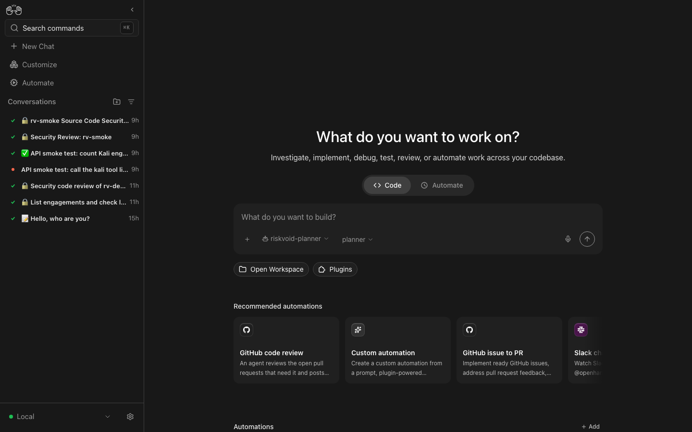

# Your first engagement (practice lab, ~20 minutes)

This walkthrough runs a real engagement end to end against **OWASP Juice Shop**, a deliberately vulnerable app
that runs in the kit's isolated lab network. No client data and no permission questions: the target is on your
machine and can't reach the internet.

You need the kit set up (`./rvkit setup`) and an OpenRouter key in `.env` for the planner. A worker model is
optional for this walkthrough: without one, the planner runs the Kali tools itself.

## 1. Check the stack

```sh
./rvkit doctor
```

Every line should be ✔ or a ! warning. Fix any ✘ first; the message says how.

## 2. Start the lab and the practice engagement

```sh
./rvkit quickstart
```

This starts the lab targets, creates the engagement `lab-juice` (scope: `10.250.0.10`, tiers passive and active),
prints a ready-made prompt and opens http://localhost:8000/.

The engagement's files are in your engagements folder (`~/riskvoid/engagements/lab-juice/` by default):

| File | What it is |
|---|---|
| `SCOPE.md` | the authorised targets. Only these can be reached by the tools |
| `RULES.md` | tiers, rate limit, online/offline, private worker |
| `report/meta.txt` | the client name on the report |

## 3. Give the agent the task

The UI opens with the `riskvoid-planner` agent and the `planner` model selected:



Paste the prompt `quickstart` printed and send it:

> Engagement `lab-juice`: web application test of OWASP Juice Shop at http://10.250.0.10:3000 (a deliberately
> vulnerable practice app in the isolated lab). Follow the web-app playbook, passive and active tiers only,
> record what you find, then write the executive summary and generate the report.

What happens next:

1. The planner reads the engagement scope and rules, picks the `web-app` playbook and writes `PLAN.md`.
2. It works through the checklist: crawling, scanning (nuclei, ZAP, ffuf, …) through the `kali` tool, or by
   handing focused tasks to the worker model when one is connected.
3. It records findings as **candidates**, verifies them, and marks them **confirmed** or **false-positive**.
4. It writes `report/executive-summary.md` and generates the report.

A run takes 10–30 minutes, depending on the models.

## 4. Watch and approve

In a second terminal:

```sh
./rvkit watch
```

This engagement allows only passive and active commands, so nothing should need approval. If you add `intrusive`
to its `RULES.md` (then `./rvkit scope lab-juice --yes`), commands like `sqlmap` wait for you: `watch` shows a
desktop notification and asks you to approve (`a`), deny (`d`) or skip (`s`).

Other things to try while it runs:

```sh
./rvkit status            # services, models, spend, engagements, pending approvals
./rvkit audit lab-juice   # every command the agent ran, refused or had approved
./rvkit halt lab-juice    # stop everything for this engagement (./rvkit resume lab-juice to continue)
```

## 5. Read the report

When the agent says the report is done, open `~/riskvoid/engagements/lab-juice/report/`:

- `*.docx` and `*.pdf`: the client report. Each finding lists its evidence files with their SHA-256 and the
  audited command that produced them.
- `*.xlsx`: the findings register.

If the report says **DRAFT**, its first page lists what's missing (for example, unverified candidates). Ask the
agent to fix those and generate it again, or run `./rvkit report lab-juice` yourself.

## 6. Close out

```sh
./rvkit close lab-juice
./rvkit lab down
```

`close` writes a SHA-256 manifest of the engagement folder, archives it with its own checksum and halts the
engagement. `lab down` removes the lab targets; they start clean next time.

## Next: a real engagement

1. Put the client's code in `~/riskvoid/projects/<repo>` (if there is any).
2. `./rvkit new`: name, client, targets, tiers, rate, online/offline.
3. Start a new conversation with `riskvoid-planner` and name the engagement in your first message.

Only test systems you have written permission to test.
